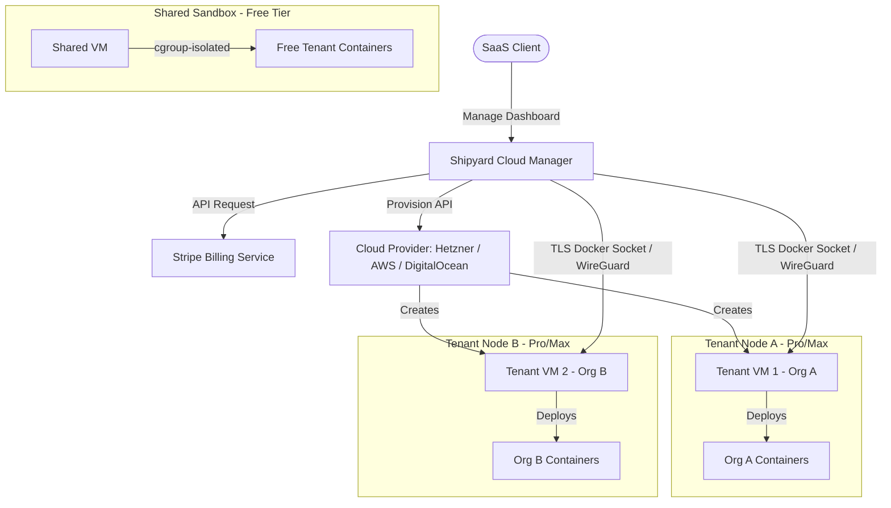

# Plan: Shipyard SaaS/PaaS Managed Cloud Platform Architecture

This document describes the design, system architecture, and database changes required to transform Shipyard from a self-hosted single-tenant server into a multi-tenant SaaS / Platform-as-a-Service (PaaS) platform. Under this model, users can sign up, create organizations, configure dedicated VMs/compute nodes on-demand, and manage deployments according to their tier plans.

---

## 1. High-Level Architecture



The platform separates the **Control Plane** (Shipyard Manager) from the **Data Plane** (Tenant VMs/Compute Nodes):

- **Control Plane**: Centralized dashboard, billing, authentication, routing rules, and deployment triggers.
- **Data Plane**: Dedicated VMs (Pro/Max) or cgroup-isolated slots on a shared VM (Free). User containers, databases, and static sites run solely on these tenant nodes.

---

## 2. Subscription Tiers & Feature Gating

| Tier | Compute | RAM Limit | Custom Domains | Replicas |
| :--- | :--- | :--- | :--- | :--- |
| **Free** | Shared sandbox VM (cgroup-isolated slot) | 512 MB | Subdomain only (`*.shipyard.host`) | 1 replica |
| **Pro** | 1 Dedicated VM (2 vCPU, 4 GB RAM) | 4 GB | Unlimited custom domains | Up to 5 replicas |
| **Max** | Up to 5 Dedicated VMs (clustered) | Up to 16 GB | Unlimited + custom CDN | Up to 20 replicas + auto-scaling |

### Free Tier Isolation Requirements

"Shared sandbox" is not simply "put everyone on the same VM." The following must be enforced at the infrastructure level before any free tier traffic is accepted:

- **CPU**: Each free org is assigned a cgroup CPU quota (`cpu.cfs_quota_us`) limiting burst to at most 0.5 vCPU sustained.
- **Memory**: Docker `--memory` + `--memory-swap` flags enforced per container. OOM kills are contained to that org's namespace.
- **Network**: Each free org gets its own Docker network. No cross-org container DNS resolution is possible.
- **Disk**: Each free org's volume mounts are scoped to `/data/tenants/<org_id>/`. Disk quotas enforced via project quotas on the host filesystem (ext4/xfs). No shared volume mounts.
- **Process limits**: `--pids-limit` on all free-tier containers to prevent fork bombs.

> **Decision**: Free tier isolation is **best-effort for MVP**. Hard multi-tenant enforcement (cgroup v2 + project quotas) is added before the shared sandbox reaches more than ~20 active orgs. This must be documented in the ToS.

---

## 3. Agent Model: TLS Docker Socket

**Decision: use a TLS-secured remote Docker socket, not SSH tunnels or a custom agent.**

Rationale:
- The existing `BollardDockerEngine` already abstracts the Docker API. Targeting a remote socket only requires changing `DOCKER_HOST=tcp://<node-ip>:2376` — no new deployment code.
- SSH tunnels are fragile under reconnects and add latency per-operation.
- A custom agent is the most correct long-term but is scope-creep for MVP.

### How it works

1. During cloud-init bootstrapping, the VM generates a Docker daemon TLS certificate signed by the Shipyard Manager's CA.
2. The Manager stores the node's TLS cert + key in the `compute_nodes` table (encrypted at rest using the existing `secret_key`).
3. When a deployment targets a node, `DeploymentEngine` instantiates a `BollardDockerEngine::with_tls(node_ip, tls_creds)` instead of the local socket.
4. WireGuard provides the encrypted overlay network so the TLS socket is never exposed on a public IP.

### Node Docker Setup (cloud-init)

```bash
# On new VM — generated by Shipyard Manager and injected via cloud-init userdata
apt-get install -y docker-ce wireguard
systemctl enable docker

# Configure Docker daemon to listen on TLS socket
cat > /etc/docker/daemon.json <<EOF
{
  "hosts": ["unix:///var/run/docker.sock", "tcp://0.0.0.0:2376"],
  "tls": true,
  "tlscacert": "/etc/docker/ca.pem",
  "tlscert": "/etc/docker/server-cert.pem",
  "tlskey": "/etc/docker/server-key.pem"
}
EOF

# Join WireGuard overlay (peer config injected by manager)
wg-quick up wg0
```

---

## 4. Database Schema Extensions

### New Tables

```sql
-- Migration: backend/crates/db/migrations/20250101000023_saas_billing_and_nodes.sql

-- 1. Subscription Tiers Enum
CREATE TYPE subscription_tier AS ENUM ('free', 'pro', 'max');

-- 2. Provisioning State Machine Enum
CREATE TYPE node_status AS ENUM (
    'provisioning',       -- cloud API call in flight
    'cloud_init_running', -- VM booted, cloud-init executing
    'wireguard_joined',   -- WireGuard peer registered
    'active',             -- TLS handshake verified, accepting deployments
    'degraded',           -- reachable but health checks failing
    'failed',             -- provisioning failed; requires manual intervention
    'stopped'             -- intentionally shut down (billing event)
);

-- 3. Organizations Billing Info
CREATE TABLE org_billing (
    org_id             UUID PRIMARY KEY REFERENCES organizations(id) ON DELETE CASCADE,
    stripe_customer_id TEXT UNIQUE,
    stripe_sub_id      TEXT UNIQUE,
    tier               subscription_tier NOT NULL DEFAULT 'free',
    sub_status         TEXT NOT NULL DEFAULT 'active', -- 'active', 'past_due', 'canceled'
    current_period_end TIMESTAMPTZ,
    updated_at         TIMESTAMPTZ NOT NULL DEFAULT NOW()
);

-- 4. Compute Nodes
CREATE TABLE compute_nodes (
    id                    UUID PRIMARY KEY DEFAULT gen_random_uuid(),
    org_id                UUID NOT NULL REFERENCES organizations(id) ON DELETE CASCADE,
    name                  TEXT NOT NULL,
    provider              TEXT NOT NULL,              -- 'hetzner', 'digitalocean', 'aws'
    provider_vm_id        TEXT,                       -- Remote instance ID from cloud provider
    region                TEXT NOT NULL,              -- e.g. 'eu-central', 'us-east-1', 'nyc3'
    ip_address            TEXT,                       -- WireGuard overlay IP (not public)
    public_ip             TEXT,                       -- Used only during bootstrap, then locked
    status                node_status NOT NULL DEFAULT 'provisioning',
    last_heartbeat_at     TIMESTAMPTZ,               -- Updated by health-check loop
    cpu_cores             INT NOT NULL DEFAULT 1,
    ram_mb                INT NOT NULL DEFAULT 1024,
    tls_ca_cert           TEXT,                       -- CA cert PEM (encrypted)
    tls_client_cert       TEXT,                       -- Client cert PEM (encrypted)
    tls_client_key        TEXT,                       -- Client key PEM (encrypted)
    provision_error       TEXT,                       -- Last error message if status = 'failed'
    provision_attempts    INT NOT NULL DEFAULT 0,
    created_at            TIMESTAMPTZ NOT NULL DEFAULT NOW(),
    updated_at            TIMESTAMPTZ NOT NULL DEFAULT NOW()
);

CREATE INDEX idx_compute_nodes_org    ON compute_nodes(org_id);
CREATE INDEX idx_compute_nodes_status ON compute_nodes(status);

-- 5. Service → Node Assignment
-- Decouples which node a service runs on from the service record itself.
-- Allows services to be migrated between nodes without changing service IDs.
CREATE TABLE service_node_assignments (
    service_id  UUID NOT NULL REFERENCES services(id) ON DELETE CASCADE,
    node_id     UUID NOT NULL REFERENCES compute_nodes(id) ON DELETE RESTRICT,
    assigned_at TIMESTAMPTZ NOT NULL DEFAULT NOW(),
    PRIMARY KEY (service_id)
);

CREATE INDEX idx_sna_node ON service_node_assignments(node_id);
```

### Key Design Decisions

- **`region` on `compute_nodes`** is required from day one. Retrofitting it after launch requires a migration that touches every node record and potentially every Traefik routing rule.
- **`service_node_assignments`** is a separate table (not a column on `services`) so that node reassignment during upgrade/migration is an atomic row swap, not a multi-column update that could leave a service in an inconsistent state.
- **TLS credentials** are stored encrypted in the DB using the existing `secret_key` / `encrypt_or_passthrough` pattern already used for env vars and webhook tokens.
- **`last_heartbeat_at`** is updated by the health-check background loop (see §6). A node with no heartbeat for >2 minutes is marked `degraded` automatically.

---

## 5. Compute Provisioning Engine

### Provider Abstraction

```rust
#[async_trait]
pub trait ComputeProvider: Send + Sync {
    async fn create_vm(
        &self,
        name: &str,
        region: &str,
        plan: &str,              // e.g. "cpx21" on Hetzner, "s-2vcpu-4gb" on DO
        cloud_init: &str,        // rendered userdata script
    ) -> Result<VmDetails, ProviderError>;

    async fn delete_vm(&self, vm_id: &str) -> Result<(), ProviderError>;
    async fn get_vm_status(&self, vm_id: &str) -> Result<VmStatus, ProviderError>;
}

pub struct VmDetails {
    pub provider_vm_id: String,
    pub public_ip: String,
    pub region: String,
}
```

Implementations: `HetznerProvider`, `DigitalOceanProvider`, `AwsProvider`. Each talks to its cloud API and returns a `VmDetails`.

### Provisioning State Machine

```
         ┌─────────────────────────────────────────────────────────────┐
         │                                                             │
  [API]  ▼                                                            │ retry (≤3)
  provisioning ──► cloud_init_running ──► wireguard_joined ──► active │
         │                 │                     │               │     │
         │                 └─────────────────────┘               │     │
         │                           │ timeout / error            │     │
         │                           ▼                            │     │
         └──────────────────────► failed ◄───────────────────────┘     │
                                     │                                 │
                                     └─────────────────────────────────┘
```

Each state transition is persisted to `compute_nodes.status`. A background worker polls nodes in `provisioning` and `cloud_init_running` states every 30 s, checks the cloud provider API, and advances the state.

- **`provisioning → cloud_init_running`**: cloud API reports VM is `running`
- **`cloud_init_running → wireguard_joined`**: WireGuard peer shows up in `wg show` on the manager
- **`wireguard_joined → active`**: TLS handshake to `tcp://<wireguard-ip>:2376` succeeds
- Any step → **`failed`** after 3 attempts or 15 min timeout; `provision_error` is set
- **`active → degraded`**: heartbeat missed for >2 min
- **`degraded → active`**: heartbeat resumes
- **`active/degraded → stopped`**: billing cancellation event

### Billing Reconciliation Loop

The Stripe webhook flow has a failure window: payment succeeds but VM provisioning fails. To handle this:

1. `checkout.session.completed` → create `compute_nodes` row with `status = 'provisioning'` + `stripe_sub_id`
2. A **reconciliation worker** runs every 5 minutes:
   - Finds `org_billing` rows where `tier != 'free'` but org has no `active` node
   - If within 30 min of upgrade: retries provisioning (up to 3 times)
   - If >30 min elapsed with no active node: marks the subscription for manual review and alerts ops (email / Slack webhook)
3. `customer.subscription.deleted` → marks node `stopped`, containers are drained gracefully (30 s), then VM is deleted via cloud API after a 24 h grace period (allows users to export data)

---

## 6. Service-to-Node Routing & Migration

### How `DeploymentEngine` selects a node

```
deploy(service_id) →
  1. look up service_node_assignments WHERE service_id = $1
  2. if no assignment → use org's default node (first `active` node for that org)
  3. instantiate BollardDockerEngine::with_tls(node.ip_address, node.tls_creds)
  4. run deployment as normal
```

### Upgrade migration (Free → Pro)

When an org upgrades from Free to Pro, existing services must move from the shared sandbox to the new dedicated VM. The migration sequence:

1. Provision dedicated VM (status: `provisioning` → `active`)
2. For each service in the org (ordered by least-recently-deployed first):
   a. Re-deploy the service on the new node (using existing image / last deployment ref)
   b. Wait for health check to pass on new node
   c. Atomically swap `service_node_assignments.node_id` to the new node
   d. Update Traefik dynamic config to route to new node IP
   e. Give old container 30 s drain window, then stop it on the shared sandbox
3. Release the shared sandbox slot for that org

**No hard downtime window** — traffic is routed to the old container until the new one is healthy. Brief (~1–2 s) reconnect during Traefik config hot-reload.

---

## 7. Network & Routing

### WireGuard Overlay

Each organization gets a `/30` subnet within the `10.100.0.0/16` overlay range:
- Manager: `10.100.0.1` (central peer, always-on)
- Org A node 1: `10.100.1.1`, Org A node 2: `10.100.1.2`, ...
- Org B node 1: `10.100.2.1`, ...

Nodes in different orgs cannot reach each other's overlay IPs — standard WireGuard peer config (only list peers you should talk to).

### Traefik Routing Multi-Tenancy

Traefik dynamic config (already used in self-hosted mode) is extended to target tenant node IPs:

```yaml
# Generated per service — written to traefik/dynamic/<service-slug>.yml
http:
  routers:
    my-service:
      rule: "Host(`my-service.shipyard.host`)"
      service: my-service-backend
  services:
    my-service-backend:
      loadBalancer:
        servers:
          - url: "http://10.100.1.1:3000"   # WireGuard overlay IP of tenant node
```

SSL certificates continue to be managed centrally by Traefik via Let's Encrypt.

---

## 8. Billing Integration (Stripe Webhooks)

Handler: `POST /api/billing/webhooks`

| Stripe Event | Action |
| :--- | :--- |
| `checkout.session.completed` | Upsert `org_billing` to new tier; create `compute_nodes` row; enqueue provisioning task |
| `customer.subscription.updated` | Update `sub_status`, `current_period_end`; handle plan change (up/downgrade) |
| `customer.subscription.deleted` | Set `sub_status = 'canceled'`; drain containers; queue VM deletion after 24 h grace |
| `invoice.payment_failed` | Set `sub_status = 'past_due'`; notify org owner; block new deployments after 7-day grace |

The Stripe webhook endpoint verifies the `Stripe-Signature` header using the webhook signing secret before processing any event (same HMAC-SHA256 pattern as the existing Git webhooks).

---

## 9. Open Questions (Decided Later)

| Question | Default for MVP |
| :--- | :--- |
| Custom regions (user selects datacenter) | Fixed to one region per provider at launch; `region` column reserved |
| Auto-scaling on Max tier | Manual replica scaling only at launch |
| Shared sandbox node count | One shared sandbox per region; add more when tenant count > 50 |
| VPN alternative (Tailscale vs WireGuard) | WireGuard (self-managed, no third-party dependency) |
| Free tier abuse / rate limiting | IP-level rate limit on API + deploy concurrency limit of 1 per free org |
