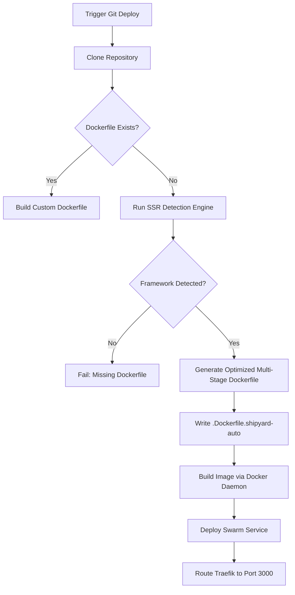

# Architectural Design: Zero-Config SSR Deployment Support in Shipyard

This document outlines the design and implementation plan to add Vercel-style, zero-configuration Server-Side Rendering (SSR) deployment support for **Next.js**, **SvelteKit**, and **Nuxt.js** on Shipyard.

---

## 1. Core Concept & Comparison

| Feature | Static Site (`static` type) | SSR Application (`git` type / SSR mode) |
| :--- | :--- | :--- |
| **Output** | HTML, CSS, JS static files | Persistent Node.js/Bun runtime process |
| **Serving Layer** | Host-level Nginx (`shipyard-nginx-static`) | Docker Swarm Service + Traefik Routing |
| **Execution** | Purely client-side (no server-side compute) | Dynamic server-side rendering per request |
| **Data Flow** | Browser $\rightarrow$ Nginx $\rightarrow$ Static files | Browser $\rightarrow$ Traefik $\rightarrow$ Node.js Container (Port 3000) |
| **Configuration** | Static assets directory mapping | Zero-config generated container environment |

---

## 2. Current Shipyard Architecture Analysis

Currently, Shipyard has two core build flows:
1. **Static Build (`static` service)**: Clones a git repo, compiles it using an ephemeral builder container (Node/Bun), copies the static files to `/opt/shipyard/data/static/`, and configures Nginx.
2. **Git Container Build (`git` service)**: Clones a git repo, checks for a `Dockerfile` in the root, compiles a Docker image using `docker.build_image`, and spawns a Docker Swarm service. **If no `Dockerfile` exists, the deployment fails.**

### Proposed SSR Design
Instead of forcing users to write a custom `Dockerfile` to host their Next.js, Nuxt, or SvelteKit SSR apps, we will extend the `git` service build flow to **auto-detect** JS/TS frameworks and **dynamically generate** a highly optimized multi-stage `Dockerfile` on the fly.



---

## 3. Auto-Detection Engine

We can implement a detection module in `backend/crates/engine/src/ssr.rs` (or inside `static_site.rs`):

```rust
pub enum SsrFramework {
    NextJs,
    SvelteKit,
    Nuxt,
}

pub struct DetectedSsr {
    pub framework: SsrFramework,
    pub dockerfile_content: String,
    pub default_port: u16,
}
```

### Detection Logic
1. **Next.js**: Presence of `next.config.js`, `next.config.ts`, or `next.config.mjs`.
2. **SvelteKit**: Presence of `svelte.config.js` or `svelte.config.ts`.
3. **Nuxt.js**: Presence of `nuxt.config.js` or `nuxt.config.ts`.

---

## 4. Optimized Multi-Stage Dockerfile Templates

By utilizing multi-stage builds, the developer's VPS will build the application inside isolated containers, ensuring no node modules or compilers pollute the host machine.

### Template A: Next.js (Standalone SSR)
Next.js supports a standalone build mode that copies only the necessary files for production, reducing the final image size by up to 90% (often < 120MB instead of 1GB+).

amtiss:<client_id>:<module_id>:imrovementA

```dockerfile
# Stage 1: Dependencies
FROM node:22-alpine AS deps
RUN apk add --no-cache libc6-compat
WORKDIR /app
COPY package.json package-lock.json* yarn.lock* pnpm-lock.yaml* bun.lockb* ./
RUN \
  if [ -f pnpm-lock.yaml ]; then corepack enable pnpm && pnpm i --frozen-lockfile; \
  elif [ -f yarn.lock ]; then yarn install --frozen-lockfile; \
  elif [ -f bun.lockb ]; then corepack enable bun && bun install --frozen-lockfile; \
  else npm ci; \
  fi

# Stage 2: Builder
FROM node:22-alpine AS builder
WORKDIR /app
COPY --from=deps /app/node_modules ./node_modules
COPY . .
ENV NEXT_TELEMETRY_DISABLED=1
RUN \
  if [ -f pnpm-lock.yaml ]; then corepack enable pnpm && pnpm run build; \
  elif [ -f yarn.lock ]; then yarn build; \
  elif [ -f bun.lockb ]; then corepack enable bun && bun run build; \
  else npm run build; \
  fi

# Stage 3: Runner
FROM node:22-alpine AS runner
WORKDIR /app
ENV NODE_ENV=production
ENV PORT=3000
ENV HOSTNAME="0.0.0.0"

COPY --from=builder /app/public ./public
# Leverages Next.js Standalone build (requires output: 'standalone' in next.config)
COPY --from=builder /app/.next/standalone ./
COPY --from=builder /app/.next/static ./.next/static

EXPOSE 3000
CMD ["node", "server.js"]
```
> [!NOTE]
> We should check if `next.config` contains the `"standalone"` string. If not, we will output a warning in the build logs recommending they enable it for optimal image sizes, or fall back to a full build copy if necessary.

### Template B: SvelteKit (Node SSR)
SvelteKit SSR requires `@sveltejs/adapter-node` to compile to a standalone HTTP server.

```dockerfile
# Stage 1: Build
FROM node:22-alpine AS builder
WORKDIR /app
COPY package.json package-lock.json* yarn.lock* pnpm-lock.yaml* bun.lockb* ./
RUN \
  if [ -f pnpm-lock.yaml ]; then corepack enable pnpm && pnpm i; \
  elif [ -f yarn.lock ]; then yarn install; \
  elif [ -f bun.lockb ]; then corepack enable bun && bun install; \
  else npm ci; \
  fi
COPY . .
RUN \
  if [ -f pnpm-lock.yaml ]; then corepack enable pnpm && pnpm run build; \
  elif [ -f yarn.lock ]; then yarn build; \
  elif [ -f bun.lockb ]; then corepack enable bun && bun run build; \
  else npm run build; \
  fi

# Stage 2: Runner
FROM node:22-alpine AS runner
WORKDIR /app
ENV NODE_ENV=production
ENV PORT=3000
ENV HOST=0.0.0.0
COPY --from=builder /app/package.json ./
COPY --from=builder /app/package-lock.json* /app/yarn.lock* /app/pnpm-lock.yaml* /app/bun.lockb* ./
RUN \
  if [ -f pnpm-lock.yaml ]; then corepack enable pnpm && pnpm i --prod; \
  elif [ -f yarn.lock ]; then yarn install --production; \
  elif [ -f bun.lockb ]; then corepack enable bun && bun install --production; \
  else npm ci --omit=dev; \
  fi
COPY --from=builder /app/build ./build
EXPOSE 3000
CMD ["node", "build/index.js"]
```

### Template C: Nuxt.js (Nitro SSR)
Nuxt uses the Nitro server engine, which produces a standalone runtime in `.output/server` by default.

```dockerfile
# Stage 1: Build
FROM node:22-alpine AS builder
WORKDIR /app
COPY package.json package-lock.json* yarn.lock* pnpm-lock.yaml* bun.lockb* ./
RUN \
  if [ -f pnpm-lock.yaml ]; then corepack enable pnpm && pnpm i; \
  elif [ -f yarn.lock ]; then yarn install; \
  elif [ -f bun.lockb ]; then corepack enable bun && bun install; \
  else npm ci; \
  fi
COPY . .
RUN \
  if [ -f pnpm-lock.yaml ]; then corepack enable pnpm && pnpm run build; \
  elif [ -f yarn.lock ]; then yarn build; \
  elif [ -f bun.lockb ]; then corepack enable bun && bun run build; \
  else npm run build; \
  fi

# Stage 2: Runner
FROM node:22-alpine AS runner
WORKDIR /app
ENV NODE_ENV=production
ENV PORT=3000
ENV HOST=0.0.0.0
COPY --from=builder /app/.output ./.output
EXPOSE 3000
CMD ["node", ".output/server/index.mjs"]
```

---

## 5. Backend Implementation Steps

### Step 1: Intercept `step_acquire_image`
In `backend/crates/engine/src/lib.rs`, we can replace the hard error when `Dockerfile` is absent:

```rust
// Old logic:
// let dockerfile_path = format!("{repo_path}/Dockerfile");
// if !Path::new(&dockerfile_path).exists() { return Err(AppError::BadRequest(...)) }

// New Logic:
let dockerfile_name = if Path::new(&format!("{repo_path}/Dockerfile")).exists() {
    "Dockerfile".to_string()
} else {
    // Attempt SSR framework detection
    if let Some(ssr_detect) = detect_ssr_framework(Path::new(repo_path)) {
        let auto_dockerfile_path = format!("{repo_path}/Dockerfile.shipyard-auto");
        std::fs::write(&auto_dockerfile_path, &ssr_detect.dockerfile_content)
            .map_err(|e| AppError::Internal(format!("Failed to write auto-generated Dockerfile: {e}")))?;
        
        self.insert_log(deployment_id, Some(step_id), "info", 
            &format!("Auto-detected {} SSR project. Generated optimized Dockerfile.", ssr_detect.framework_name())).await;
        
        "Dockerfile.shipyard-auto".to_string()
    } else {
        return Err(AppError::BadRequest(
            "No Dockerfile found, and no supported SSR framework (Next.js, SvelteKit, Nuxt.js) was detected.".to_string()
        ));
    }
};
```

### Step 2: Handle Port Mapping
SSR containers listen on a port (usually `3000`). Traefik needs to know this backend port.
Currently, `backend/crates/engine/src/lib.rs` reads the `ports` column from the database.
If a `git` service doesn't have an explicit port set, but we auto-detected an SSR framework:
1. We can default the Traefik routing port to `3000` (instead of throwing a warning about auto-detecting).
2. Alternatively, during detection, if the database `ports` field is empty, the backend can update the service's `ports` column to `["3000"]` automatically so it works cleanly without other logic changes.

---

## 6. Key Considerations & UX Enhancements

* **Next.js Standalone Mode**:
  Next.js requires `"output": "standalone"` in `next.config.js` for our optimized build. We should check if `next.config.js/ts` contains this string. If not, we can output a message in the build log: 
  `"💡 Note: For best results and smaller images, add 'output: standalone' to your next.config.js."`
* **Monorepos**:
  Many Next/SvelteKit projects live in a monorepo subfolder. Shipyard already supports setting `directory_path` on services. The framework detection engine should scan `repo_path.join(directory_path)` instead of only the repository root.
* **Build Resources**:
  SSR builds (specifically Next.js and Nuxt) are CPU and memory-intensive. Ensuring the builder container doesn't get OOM-killed on smaller 1GB VPS hosts is crucial. We may want to set swap memory or limit node memory usage (e.g., `NODE_OPTIONS="--max-old-space-size=1536"`).
