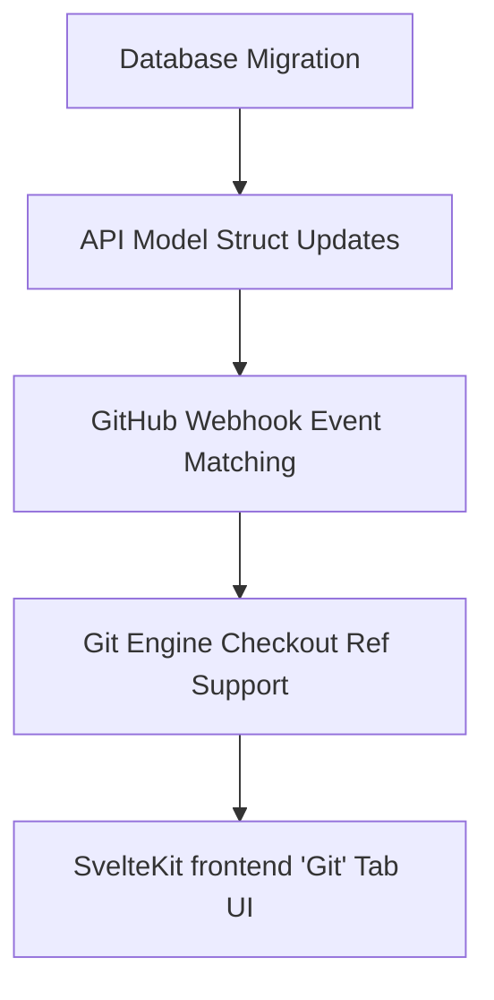

# Plan: Git Deployment Strategies for Static Services

This document details the implementation plan for introducing Git deployment strategies to static services deployed from GitHub. This allows users to configure whether a deployment should be automatically triggered on:
1. **Push to branch** (e.g. `main`, `production`)
2. **Push to tag** (e.g. `v*`, `release-*`)
3. **Pull Request merge** (when merged into a target branch)

---

## 1. Database Changes

We need to persist the deployment strategy settings for each static service. We will add three fields to `static_site_configs`:
- `git_deploy_strategy` (enum/text): `'push' | 'tag' | 'pull_request'` (default `'push'`)
- `git_deploy_branch` (text, nullable): Target branch name for branch pushes or pull request merges.
- `git_deploy_tag_pattern` (text, nullable): Optional wildcard/glob pattern for tag pushes (e.g. `v*`).

### Migration File
Create `backend/crates/db/migrations/20250101000022_static_git_strategy.sql`:
```sql
-- Add Git deployment strategy fields to static_site_configs
ALTER TABLE static_site_configs ADD COLUMN IF NOT EXISTS git_deploy_strategy TEXT NOT NULL DEFAULT 'push';
ALTER TABLE static_site_configs ADD COLUMN IF NOT EXISTS git_deploy_branch TEXT;
ALTER TABLE static_site_configs ADD COLUMN IF NOT EXISTS git_deploy_tag_pattern TEXT;
```

---

## 2. API & Data Models (Rust Backend & TypeScript Frontend)

### A. Backend Route & Model Updates
Modify `backend/crates/api/src/static_site/mod.rs`:
- Update `StaticConfigResponse` and `UpdateStaticConfigRequest` structs:
  ```rust
  #[derive(Debug, Serialize)]
  pub struct StaticConfigResponse {
      // Existing fields...
      pub git_deploy_strategy:    String,
      pub git_deploy_branch:      Option<String>,
      pub git_deploy_tag_pattern: Option<String>,
  }

  #[derive(Debug, Deserialize)]
  pub struct UpdateStaticConfigRequest {
      // Existing fields...
      pub git_deploy_strategy:    Option<String>,
      pub git_deploy_branch:      Option<String>,
      pub git_deploy_tag_pattern: Option<String>,
  }
  ```
- Update queries in `get_static_config` and `put_static_config` to read and save these new columns.

### B. Frontend TypeScript Types
Modify `frontend/src/lib/api/types.ts` to include the new fields on `StaticSiteConfig`:
```typescript
export interface StaticSiteConfig {
	// Existing fields...
	git_deploy_strategy:   'push' | 'tag' | 'pull_request';
	git_deploy_branch?:    string;
	git_deploy_tag_pattern?: string;
}
```

---

## 3. Webhook Controller Updates (GitHub Events)

Currently, the webhook handler only handles push events and checks if they match the service's default branch. We will update the GitHub webhook receiver to support custom event actions.

Modify `backend/crates/api/src/webhooks/mod.rs`:
1. Parse the header `x-github-event` to determine the event type (`push` or `pull_request`).
2. Read the service type and `static_site_configs` settings for the matching service ID.
3. Apply strategy matching:
   - **For `push` strategy**:
     - Check that `ref` starts with `refs/heads/`.
     - Extract pushed branch name.
     - Verify it matches `git_deploy_branch` (falls back to `services.git_branch`).
   - **For `tag` strategy**:
     - Check that `ref` starts with `refs/tags/`.
     - Extract tag name.
     - If `git_deploy_tag_pattern` is configured (e.g. `v*`), verify the tag matches the wildcard pattern using glob or standard string pattern matching.
   - **For `pull_request` strategy**:
     - Verify that `x-github-event` is `pull_request`.
     - Check that `action == "closed"` and `pull_request.merged == true` in the JSON payload.
     - Verify the target branch (`pull_request.base.ref`) matches `git_deploy_branch` (falls back to `services.git_branch`).
4. Trigger the deployment engine:
   - Pass the resolved checkout ref (the branch name, tag name, or merge commit SHA) as the `source_ref` for the deployment.

---

## 4. Git Engine Enhancements

We need to ensure that the deployment engine can checkout the specific ref (branch, tag, or commit SHA) supplied by the webhook event.

### A. Git Service Checkout Support
Modify `backend/crates/git/src/lib.rs`:
- Add a new method `checkout_ref(&self, repo_path: &str, target_ref: &str)` that resolves the reference using `git2::Repository::revparse_single`, updates the repository state (fast-forwarding or checking out detatched HEAD), and updates the working tree.

### B. Deployment Engine Integration
Modify `backend/crates/engine/src/lib.rs`:
- In `run_static_git_steps`, load the `source_ref` of the current deployment from the `deployments` table.
- Pass this `source_ref` (or default back to `services.git_branch` if empty) to `step_clone_or_pull`.
- In `step_clone_or_pull`, if the path exists, call `checkout_ref` using the target ref instead of a standard `pull_repo`.

---

## 5. Frontend UI: SvelteKit Detail Panel

We will add a new **Git** configuration tab to the static site details page.

Modify `frontend/src/lib/panels/StaticSiteDetailPanel.svelte`:
1. **Conditional tab list**: Add a `git` tab next to `Build Config` when `config.source === 'git'`:
   ```svelte
   let activeTab = $state<'overview' | 'config' | 'git' | 'deployments' | 'domains' | 'docs' | 'visitor_logs'>('overview');
   ```
2. **Git Settings Component View**:
   - Provide a section title: **Git Deployment Settings**.
   - **Strategy selection dropdown/radios**:
     - Option 1: **Deploy on Push to Branch**
       - Show inputs to select the **Target Branch**.
     - Option 2: **Deploy on Tag Push**
       - Show inputs to specify a **Tag Pattern** (e.g., `v*`, `release-*`, or `*` for all tags).
     - Option 3: **Deploy on Pull Request Merge**
       - Show inputs to select the target **Merge Branch** (when PR is merged into it).
   - Save button with saving states, error banners, and success toasts that update the config via `api.updateStaticConfig`.

---

## 6. Implementation Steps Summary


